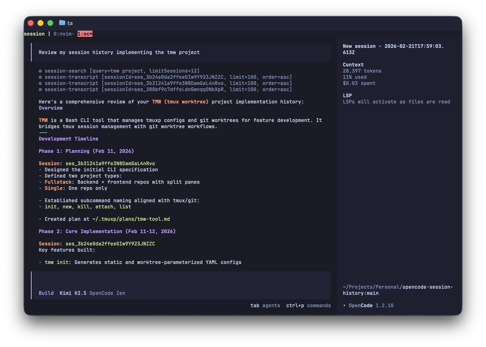

# OpenCode Session Search

A plugin for OpenCode that provides tools to search and retrieve your local chat history.



## Tools

### `session-search`

Search your local OpenCode chat history for sessions containing specific text.

**Args**
- `query` (string, required): Text to search for (1-200 chars, non-whitespace)
- `limitSessions` (number, optional): Max sessions to return (1-12, default: 6)

**Returns**
- Matching sessions with metadata (title, directory, match count)
- Snippets from each session (2 per session, 220 chars each)
- Suggested `session-transcript` calls and a `question`-tool prompt to let users pick which session to open

### `session-title-search`

Search for sessions by their title.

**Args**
- `query` (string, required): Title text to search for (1-200 chars, non-whitespace)
- `limitSessions` (number, optional): Max sessions to return (1-12, default: 6)

**Returns**
- Matching sessions with metadata (title, slug, directory, project name, timestamps)
- Suggested `session-transcript` calls and a `question`-tool prompt to let users pick which session to open

### `session-transcript`

Reconstruct the full transcript of a specific chat session.

**Args**
- `sessionId` (string, required): Session ID (e.g., `ses_xxx`)
- `limit` (number, optional): Max entries to return (1-120, default: 80)
- `order` (string, optional): `asc` or `desc` (default: `asc`)

**Returns**
- Session metadata (title, slug, directory, project info)
- Full conversation entries with timestamps and roles

## Installation

### npm (Recommended)

The default entrypoint supports OpenCode **1.18.29+** and **2.0.18+**.
OpenCode 1 calls `server()`; OpenCode 2 calls `setup()`.

For OpenCode 2, add the package to your OpenCode config:

```json
{
  "plugins": ["opencode-session-search"]
}
```

For OpenCode 1:

```json
{
  "plugin": ["opencode-session-search"]
}
```

Supported config locations:
- Global config: `~/.config/opencode/opencode.json`
- Project config: `.opencode/opencode.json`

Restart OpenCode so the plugin is loaded.

## Example Usage

```
Find my recent work on authentication:
⚙ session-search [query=auth login, limitSessions=5]

Find a session by title:
⚙ session-title-search [query=bug fix]

Get the full conversation:
⚙ session-transcript [sessionId=ses_abc123, limit=100]
```

Run the same search from your terminal:

```bash
bun run search -- "auth login" --limitSessions 5
```

This command uses the same query path as the `session-search` tool and prints JSON.

## Development

### Local install

Install directly from this repo:

```bash
bun run install:local
```

This copies the entrypoint and its supporting modules to:

```bash
~/.config/opencode/plugins/history/
```

Manual copy option:

```bash
mkdir -p ~/.config/opencode/plugins/history
cp index.ts history.ts database.ts v1.ts ~/.config/opencode/plugins/history/
```

Restart OpenCode and the tools will be available automatically.

## Versioning

This package follows Semantic Versioning (`MAJOR.MINOR.PATCH`).

- `PATCH`: backward-compatible fixes
- `MINOR`: backward-compatible features
- `MAJOR`: breaking changes

Recommended release commands:

```bash
bun pm version patch
bun pm version minor
bun pm version major
```

Then publish:

```bash
bun publish
```

## Configuration

The plugin resolves the DB path in this order:
1. `OPENCODE_DB_PATH` env var (if set)
2. `opencode debug paths db` (OpenCode 2; respects its channel and `OPENCODE_DB`)
3. `opencode db path` (OpenCode 1)
4. Fallback: `$XDG_DATA_HOME/opencode/opencode.db`, or `~/.local/share/opencode/opencode.db`

The database is opened read-only. Connection-local TEMP views normalize V1's
`session`/`message`/`part` and V2's `session_v2`/`session_message` tables. If both
layouts contain the same session ID, the V2 copy takes precedence. User text and
assistant text are searchable; reasoning, tool payloads, and control messages are
excluded. V2 text entries use a synthetic `partId` of `<message-id>:<content-index>`.
This searches the selected local database, not a remote OpenCode server.

## Publish Checklist

- Run tests and type checks: `bun run test`
- Build distributable file: `bun run build`
- Preview package contents: `bun pm pack --dry-run`
- Confirm version bump uses SemVer (`bun pm version patch|minor|major`)
- Publish: `bun publish`

## License

MIT
